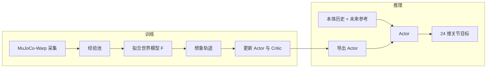
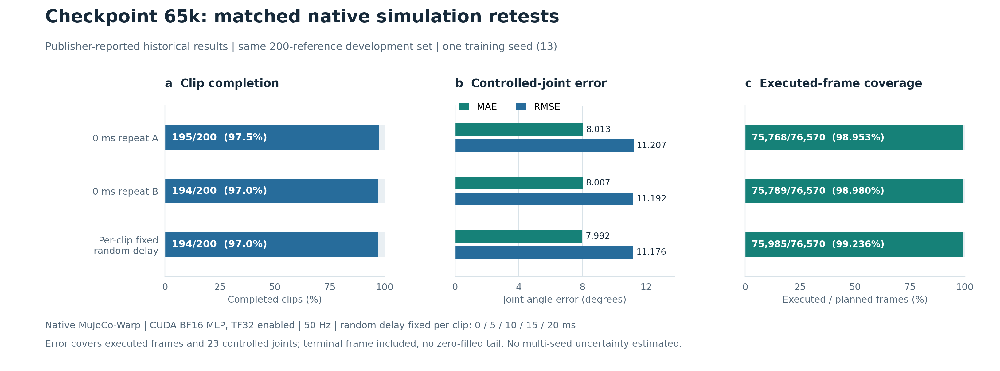
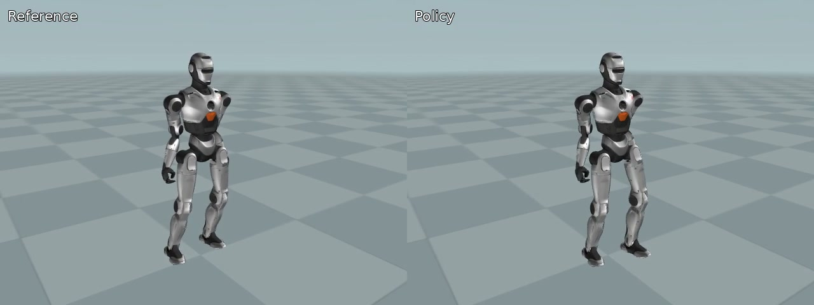

# SuperMimic PM01

SuperMimic 的 PM01 适配版。首版 **v0.1.0** 包含训练与原生评测源码、离线推理核心、**checkpoint 65k** 的轻量 Actor 和 FP32 ONNX，以及八段仿真跟踪演示。

**持续真机静站、完整敬礼和完整手柄流程尚未验收。**

*English: A PM01 adaptation of SuperMimic with a single-seed checkpoint at 65k collection steps, training source, an offline inference core, and documented simulation results. Hardware commissioning remains incomplete.*

## 1. 架构：训练与实际执行

训练时，物理仿真采集转移，世界模型 F 学习状态变化；Actor 在 F 中的可微想象轨迹上，利用参考奖励与 Critic 尾值优化。实际执行使用 Actor 和保存的归一化状态。



| 模块 | PM01 契约 |
| --- | --- |
| 本体输入 | 每帧 78 维，最近 10 帧，旧帧在前 |
| 动作参考 | 630 维，包含 10 个未来参考帧 |
| Actor | 参考编码器生成 32 维隐变量，与 780 维历史拼接；输出 23 维身体动作 |
| 关节目标 | 加入当前参考头部 yaw 后组成 24 维，策略 50 Hz |
| 学习组件 | Actor、世界模型 F、Critic 与经验池 |
| 默认参考目标 | `reference_only_v0`，未启用 `goal_feedback_v1` |

架构细节见[总览与训练/执行流程](docs/architecture.md)，PM01 的关节、观测、参考、采样和执行延迟修改见[适配说明](docs/pm01_adaptation.md)。方法来自 SuperMimic，项目贡献是 PM01 适配和相关工程实现。

## 2. 实验结果

本模型来自 **seed 13 的一个训练模型**。65k 是 65,000 个采集推进步，不是优化器更新次数。整轮在 99,918 步因持续实际跟踪退化停止，没有认定为收敛；本次分发较早的 65k 快照。

以下三项使用同一修复后原生 MuJoCo-Warp / **CUDA BF16 MLP** 协议、同一固定 200 条参考动作；评测时关闭观测噪声和域随机化：

| 评测 | 完整片段完成 | 全片归一回报 | 受控关节 MAE |
| --- | ---: | ---: | ---: |
| 0 ms 复测 A | 195/200（97.5%） | 0.835604 | 8.0129° |
| 0 ms 复测 B | 194/200（97.0%） | 0.836408 | 8.0072° |
| 每动作随机固定 0/5/10/15/20 ms | 194/200（97.0%） | 0.836666 | 7.9918° |



完成率按原生终止门限定义，不能等同于精准位置跟踪。关节误差只覆盖实际执行的帧，应与完成率和帧覆盖一起阅读。这些是发布者报告的历史 BF16 仿真成绩，**不是 FP32 ONNX 的闭环成绩**。

[实验介绍](docs/experiments.md)包含同协议的 8 个候选快照曲线、历史专项和推扰面板，以及可复用的脱敏 CSV。65k 是本次分发候选，不宣称它是所有面板或快照的全局最佳。原生门限、回报公式、数据暴露、版本和精度边界见[详细评测说明](docs/evaluation.md)。

固定 200 曾用于训练监控和模型选择，属于开发/回归集；专项含训练已见参考。单 seed 与重复评测不支持多 seed 稳定性或最终盲测泛化结论。

## 3. 闭环跟踪演示

八段 BONES 参考动作覆盖转向行走、侧步、舞蹈和上肢协调。左侧 **Reference** 是参考回放，右侧 **Policy** 是策略的实际仿真运动。各段保留完整画面，以 50 fps 原速播放，合计 44.20 秒。

参考动作来源为 [Motion Data by Bones Studio](https://bones.studio/)。

[](media/videos/showcase/05_cross_steps.mp4)

视频使用 **CPU MuJoCo 3.3.7 + ONNX Runtime FP32**，每段从参考首帧初始化，再按 50 Hz 闭环执行。按实际误差和动作类型精选的八段均执行至参考末帧，各有至少一项超出原优选条件。上方历史原生 BF16 评测使用独立协议。[全部视频与逐段误差](docs/videos.md) · [选片和探索记录](docs/video_selection_v2.md)

## 4. 权重与离线使用

本版本仓库包含两个模型文件；也可从[固定版本权重目录](https://github.com/approchin/SuperMimic-PM01/tree/v0.1.0/models)单独下载。

| 文件 | 内容 |
| --- | --- |
| `models/actor_0000065000.pt` | 65k 轻量 Actor 的元数据脱敏副本 |
| `models/actor_65000_fp32.onnx` | 原 FP32 ONNX，含观测与参考归一化 |
| [`models/SHA256SUMS.json`](models/SHA256SUMS.json) | 两个模型文件的大小与 SHA-256 |
| [`models/actor_tensor_sha256.json`](models/actor_tensor_sha256.json) | 原始 26 个模型及归一化张量的内容指纹 |

PT 清理了私有路径、动作名称和机器标识等元数据，全部 26 个张量与归档原件逐字节相同；重存改变了 PT 文件摘要。ONNX 保持原文件，其源 PT 摘要指向脱敏前原件。身份与导出说明见[模型卡](docs/model_card.md)。

将模型文件放入 `models/` 后，在仓库根目录的独立 Python 环境中运行；本次离线检查使用 Python 3.11：

```bash
python -m pip install -r inference/requirements.txt
python tools/verify_weights.py
python tools/smoke_inference.py
```

这些命令检查文件与合成输入的 CPU 推理接口。[推理说明](inference/README.md)给出输入顺序、参考编码、目标组合及可选的 CPU 重新导出入口。

## 5. 源码与复现范围

| 目录 | 内容 |
| --- | --- |
| `training/` | SuperMimic、PM01 环境、采样、执行延迟与原生评测的维护快照 |
| `inference/` | 独立 Actor 推理、PM01 数值规格及导出工具 |
| `tools/` | 权重校验、合成推理、数学接口检查、结果作图与模型页面准备 |
| `media/` | 结果图、脱敏汇总及跟踪视频 |
| `docs/` | 架构、适配、实验、模型卡、视频和发布范围 |

首版不含完整训练/评测数据、完整学习恢复点、全部原始日志或机器人模型资产，不能仅靠本包重现整轮训练与所有历史成绩。训练源码是维护版本，保留 65k 后的修复及发布整理改动；原训练 Python 为 3.10.19，与本次 CPU 环境分别记录。详见[训练说明](training/README.md)、[源码来源](training/source_provenance.json)和[发布范围](docs/release_scope.md)。

现有受控接管和约一秒软接管探针，不构成持续静站、完整敬礼或完整手柄流程的验收。首版不带真机启动入口，现场经验在后续版本补充。

## 6. 发布与许可

项目代码采用 [Apache-2.0](LICENSE)，上游 MIT、BSD 和其他声明随各自文件保留。权重适用[非商业科研模型许可 v0.1](models/LICENSE.md)，视频、截图及结果图适用[科研使用条款](media/LICENSE.md)。来源和适用条件见[第三方声明](THIRD_PARTY_NOTICES.md)。

Training data includes [Motion Data by Bones Studio](https://bones.studio/).

Use of the underlying dataset is subject to the [BONES Motion Capture Dataset License Agreement](https://bones.studio/info/seed-license).

算法与实现来源：[SuperMimic 论文](https://arxiv.org/abs/2610.28480)、[HoloMotion](https://github.com/HorizonRobotics/HoloMotion)、[supermimic_vibed 固定版本](https://github.com/zita-ch/supermimic_vibed/tree/a1508d42c9d1699a52e8233ab16d08c488441ab9)。
