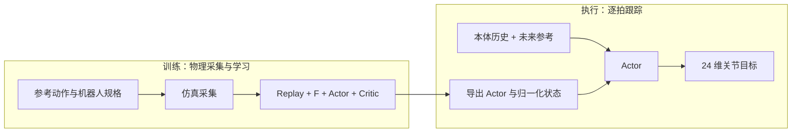
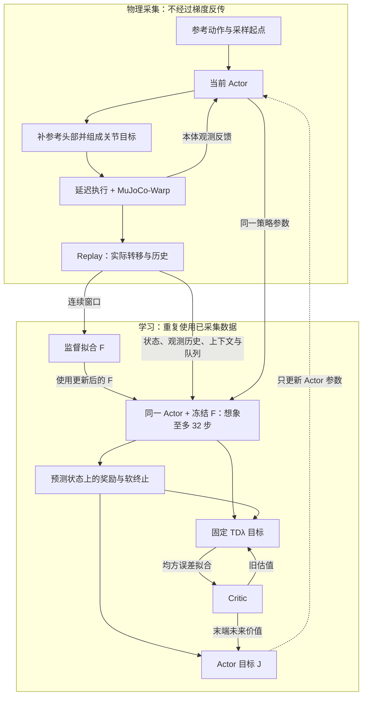
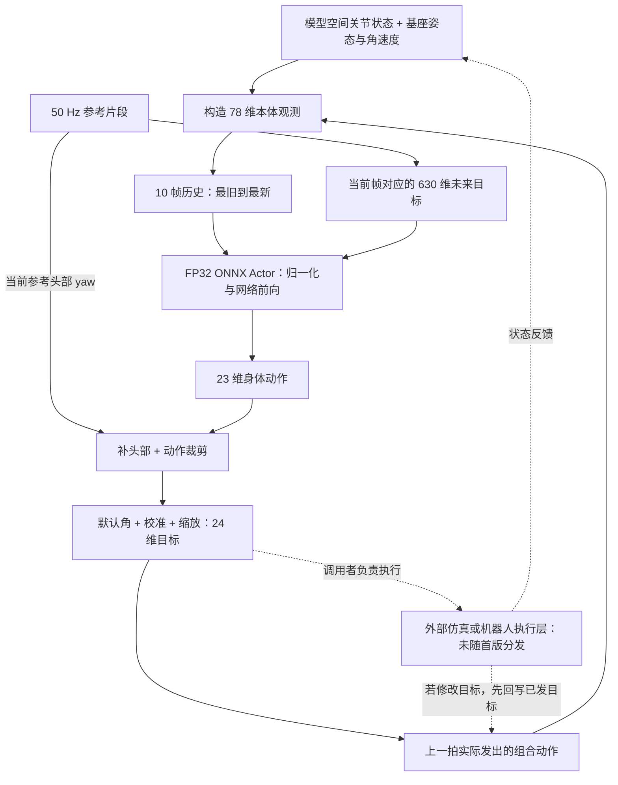

# 架构：训练出 Actor，再用 Actor 跟踪参考

SuperMimic PM01 是一个参考动作跟踪器：输入最近的机器人本体状态和未来参考，输出身体关节目标。训练时另用世界模型 F 学习动作后果，用 Critic 估计更远的未来价值；执行时只保留 Actor 与归一化状态。

本文按本仓库的维护版源码解释实现。公开代码包含 65k 之后的部分修复，与原快照的对应关系见 [`source_provenance.json`](../training/source_provenance.json)。这里介绍架构与接口，历史成绩和真机验收状态分别见[评测说明](evaluation.md)和[模型卡](model_card.md)。

*English: The PM01 tracker uses an Actor conditioned on proprioceptive history and future motion references. Training adds a learned dynamics model, replay, imagined rollouts, and a privileged Critic. Deployment exports only the Actor and its normalization state; the released runtime is an offline inference core.*

## 先看全貌



“采集”是在 MuJoCo-Warp 中执行策略并保存真实物理转移；“想象”是从已保存的状态出发，由 F 预测后续。此处的真实转移指仿真器实际积分得到的结果，不是真机数据。部署不调用 F 或 Critic。

| 模块 | 负责什么 | 训练时如何使用 | 随部署运行 |
| --- | --- | --- | --- |
| Actor | 从本体历史和未来参考输出动作 | 物理采集与想象使用同一策略 | 是 |
| 世界模型 F | 从当前状态、动作、物理上下文与延迟状态预测下一状态 | 用已采集转移监督拟合，供想象使用 | 否 |
| Critic | 估计未来折扣回报 | 拟合想象轨迹的 TDλ 目标，并给 Actor 提供尾值 | 否 |
| Replay | 保存状态、动作、参考帧、终止与队列等记录 | 给 F 抽连续窗口，给 Actor 抽想象起点和历史 | 否 |
| 解析任务函数 | 计算观测、参考、奖励、终止与动作组合 | 物理与想象共用语义 | 部署保留对应的观测、参考和动作契约 |

这些学习模块来自所沿用的 SuperMimic 实现；PM01 的维度、机器人规格、来源采样和执行延迟等适配见[PM01 适配说明](pm01_adaptation.md)。

## 训练细图



图中的三种更新有不同的目标：

1. **F 学习动作后果。** 从 replay 抽 8 步窗口，用记录的动作、物理上下文和对应时刻的延迟状态推进预测，与实际下一状态比较。拟合窗口约 0.16 秒，回合边界以后的转移被 mask 排除。F 输出的是状态增量，经积分得到下一状态，不输出 Actor 动作。
2. **Actor 学习怎样控制。** 从 replay 抽一个状态及最近 10 帧历史，使用当前 Actor 与 F 想象至多 32 步，约 0.64 秒。对预测状态用原参考计算奖励，并在窗口末尾加 Critic 估计的未来价值。更新 Actor 时，F 和 Critic 的参数冻结，但它们对输入的梯度仍保留。
3. **Critic 学习估值。** 使用这批想象轨迹的奖励、终止权重和旧估值构造固定 TDλ 目标，随后以均方误差拟合。当前配方为 `γ=0.99`、`λ=0.95`，每批拟合 5 轮、每轮 4 个小批次。其目标不是真实仿真器预先给出的完整未来。

忽略提前结束的存活系数时，Actor 最大化：

```text
J = Σ[t=0…H−1] γ^t r(ŝ[t+1], a[t]) + γ^H V(ŝ[H], g[H], ξ, D[H])
L_actor = −mean(J)
```

`ŝ` 是 F 预测的状态，`g` 是参考目标，`ξ` 是物理随机化上下文，`D` 是命令延迟状态。实际实现还乘累计存活权重：想象中的物理失败风险使用可微软终止；参考片段自然结束时保留最后有效转移的奖励，排除后续槽位并切断尾值贡献。

梯度路径为“奖励或 Critic 尾值 → 预测状态 → 冻结的 F → Actor 动作与参数”。MuJoCo 接触求解不参与这条反传。Actor 的更新不使用 PPO 的动作概率比；Critic 的目标仍采用 TDλ 递推。源码见 [`learner.py`](../training/holomotion/src/algo/supermimic/learner.py)、[`imagination.py`](../training/holomotion/src/algo/supermimic/imagination.py) 和 [`imagination_mask.py`](../training/holomotion/src/algo/supermimic/imagination_mask.py)。

## 训练知道什么，部署输入什么

训练仿真能够直接读取根位置、姿态、线/角速度和全部关节状态，还知道施加了什么物理随机化。Actor 的输入则限制为可由本体传感器及命令记录构造的字段。

| 数据 | Actor | F / Critic / 训练任务 |
| --- | --- | --- |
| 关节角、关节速度、基座角速度、投影重力、上一拍发出的动作 | 进入 78 维观测及 10 帧历史 | 也可由仿真状态计算 |
| 未来参考动作 | 630 维目标 | Critic 使用目标；奖励与终止比较原参考 |
| 实际根位置、根线速度、完整仿真状态 | 不直接输入 | Replay 保存；F 使用其去全局位置/航向的特征，任务用于积分与计分 |
| 当前机器人相对参考的根/身体误差 | 没有额外误差字段 | Critic 使用，奖励与终止也使用 |
| 摩擦、关节校准偏移、躯干质心偏移 `ξ` | 不作为独立向量输入；校准参与观测/目标变换 | F 与 Critic 显式使用 |
| 当前与待执行命令、延迟档位 `d` | 没有独立队列输入，历史含此前发出的动作 | 49 维状态进入 Replay、F、Critic 和想象推进 |

仿真状态表示为 `S=(p,R,v,ω,q,q̇)`；PM01 展平存储时用四元数表示 `R`，共 61 维。F 的输入特征去掉全局平面位置和绝对航向，保留高度、倾斜、机身坐标系速度和关节状态。Critic 还读入参考跟踪误差。因此，不能将 Critic 的训练输入当成实机 Actor 所需的传感器列表。

本轮使用原参考目标 `reference_only_v0`。630 维未来目标不加入实际根位置误差，也不启用可选的 6 维参考姿态误差观测；`goal_feedback_v1` 未用于该模型训练。Actor 仍依据关节、IMU 和动作历史闭环反应，只是没有额外的全局根误差输入。

对应定义见 [`mdp.py`](../training/holomotion/src/env/reference_tracking/mdp.py)、[`RobotSpec`](../training/holomotion/src/env/reference_tracking/spec.py)、[`ReplayBuffer`](../training/holomotion/src/algo/supermimic/buffer.py)。

## 实际推理细图

下面实线是当前离线核心的处理路径；虚线连接由调用者提供的外部执行与反馈，首版未提供该执行层。



每 20 ms 调用一次 `PolicyCore.step()`，先观察当前状态，再更新历史和推理；首次观测重复 10 次。`ReferenceClip` 已携带与当前帧对应的编码目标，Actor 不需要实际根位置或根线速度。接口接收 world-from-LINK_BASE 的 `wxyz` 姿态四元数，Actor 只读取由它算出的重力方向，不直接读取绝对 yaw。

核心默认将输出目标对应的 24 维动作作为“本次已发动作”保存。调用者若限速或修改目标，应在下一次观察前调用 `commit_issued_target()` 回写实际发出的目标。它与实测关节角是不同的数据，也不等于延迟队列里当前生效的旧目标。

`PolicyCore` 不执行 PD、定时调度、通信、速度保护或接管。历史现场外层曾按 500 Hz 刷新关节命令，但该链路不在本次离线核心中，不能从 50 Hz Actor 推理直接推出真机闭环已验收。实现见 [`policy_core.py`](../inference/supermimic_pm01/policy_core.py)，调用方式见[推理说明](../inference/README.md)。

## 网络与数值契约

| 模块 | 当前 PM01 结构 | 激活与输出 |
| --- | --- | --- |
| Actor 参考编码器 | `630→2048→1024→512→256→32` | 隐藏层 ELU，32 维隐变量 tanh |
| Actor 共享解码器 | `812→2048→1024→512→256→23` | 拼接参考隐变量 32 与历史 `10×78`，输出身体动作 |
| F | `162→2048→2048→2048→60` | 隐藏层 LayerNorm + SiLU，输出局部状态增量 |
| Critic | `840→256→128→1` | 隐藏层 ELU，输出标量价值 |

F 的 162 维输入来自状态特征 61、组合动作 24、物理上下文 28 与队列 49；其 60 维输出为位置/旋转/线速度/角速度增量各 3 维，加关节角和速度增量各 24 维。Critic 的 840 维由状态特征 61、参考跟踪及物理上下文特征 100、目标 630 和队列 49 组成。F 和 Critic 的权重不在轻量 Actor 中。

Actor 对观测和目标分别使用保存的运行均值、方差：

```text
normalize(x) = (x − mean) / sqrt(var + 0.01²)
z = tanh(encoder(normalize(goal)))
action23 = decoder(concat(z, flatten(normalize(obs_hist))))
```

ONNX 已包含这两次归一化，调用前不再手动重复执行。训练的 MLP 使用 CUDA BF16，状态积分、运动学与奖励保留 FP32；公开 ONNX 为 FP32。这是不同的前向精度协议，数值对照不能替代完整闭环评测。网络定义见 [`networks.py`](../training/holomotion/src/algo/supermimic/networks.py)，导出契约见 [`actor_65000.json`](../models/actor_65000.json)。

架构说明不改变当前发布边界：首版没有完整训练数据、物理资产或恢复点；持续真机静站与完整敬礼尚未通过验收。算法归属及第三方来源见 [`THIRD_PARTY_NOTICES.md`](../THIRD_PARTY_NOTICES.md)。
