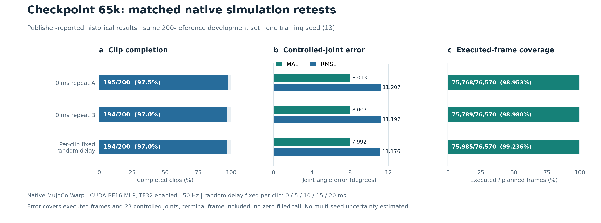
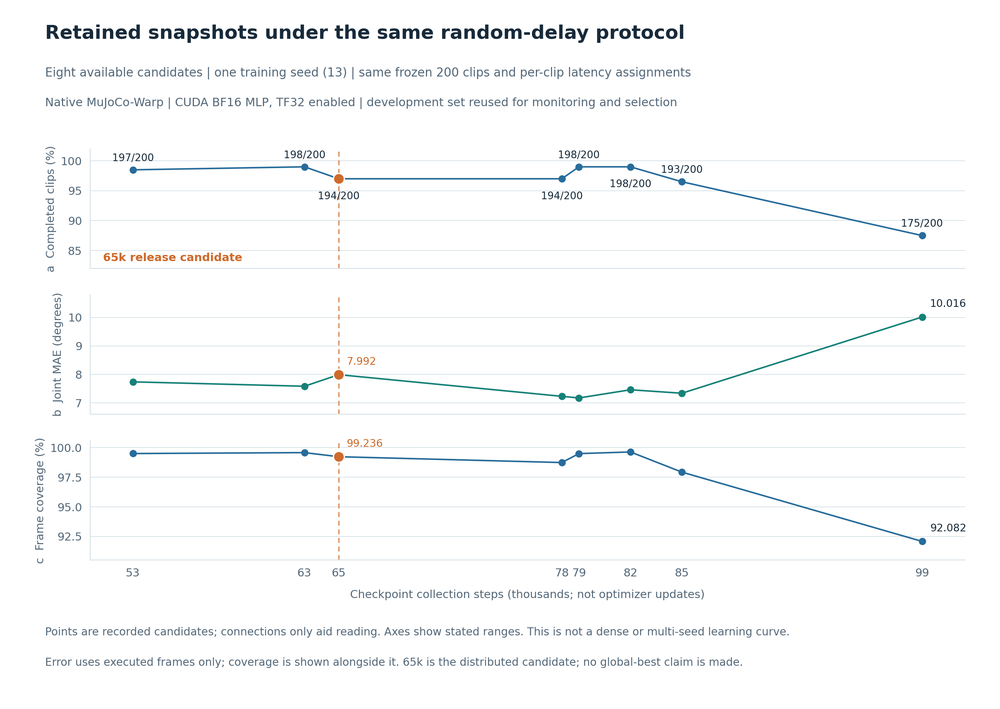

# 实验结果

本次分发的是 PM01 参考动作跟踪模型 checkpoint 65k。已有原生仿真复测中，它在同一批固定 200 条参考上的完整片段完成数为 **195、194、194**，关节 MAE 约 **8°**。本页用汇总图说明这些结果及范围；完成门限、奖励公式、数据暴露、精度与现场状态的完整定义见[评测协议与边界](evaluation.md)。

这些是发布者报告的历史结果。本页这些历史统计只核对既有记录并绘图，未重跑对应的原生 BF16 评测；视频另有独立的 CPU FP32 新录协议。训练只有 **seed 13**；固定 200 被反复用于训练监控和权重选择，属于开发/回归集。准备记录中的精确 clip 不重合，仍不足以证明录制来源独立，不能把它作为一次最终盲测。

## 65k 的三次同协议复测



图 1：同一权重、同一批 200 条参考，使用修复后的原生 MuJoCo-Warp 评测器、CUDA BF16 MLP、开启的 TF32、50 Hz 策略与 64 个并行环境；观测/reset 噪声和域随机化关闭。三列分别给出完整片段完成率、23 个策略受控关节的误差及已执行帧覆盖。外生头部 yaw 不计入关节指标。[SVG](../media/figures/native_bf16_retests_65k.svg) · [数据 CSV](../media/results/native_bf16_retests_65k.csv)。

| 任务 | 完成 | 全片归一回报 | MAE | RMSE | 已执行/计划帧 |
| --- | ---: | ---: | ---: | ---: | ---: |
| 0 ms 复测 A | 195/200（97.5%） | 0.835604 | 8.0129° | 11.2074° | 75,768/76,570（98.953%） |
| 0 ms 复测 B | 194/200（97.0%） | 0.836408 | 8.0072° | 11.1919° | 75,789/76,570（98.980%） |
| 每动作随机固定延迟 | 194/200（97.0%） | 0.836666 | 7.9918° | 11.1756° | 75,985/76,570（99.236%） |

随机延迟使用独立的 `random.Random(13)`，按冻结动作顺序为每条动作从 `0/5/10/15/20 ms` 抽取一次，并保持至片段结束。它共有 200 次动作执行；各档分别包含 29、48、47、38、38 条不同动作，不能按延迟层直接比较因果效果。[分层 CSV](../media/results/delay_strata_65k.csv) 保留各档计数。延迟分配的 seed 也不是新增训练 seed。

“完成”采用原生的根高度、身体高度和完整根旋转门限，不包含额外水平位置或关节角硬门槛。回报始终以 `0.1 × 计划步数` 为分母，提前终止后的尾段仍留在分母；关节误差只统计已经执行的帧，包含终止帧，不把未执行尾段补成零。因此完成、误差和帧覆盖应一起阅读。重复结果没有被转换为多 seed 置信区间，触发原生终止也不等于已经物理跌倒。

## 八个现存候选的同协议对照



图 2：已有随机延迟复测批次中的全部八个现存候选，共用固定 200 条参考及逐动作延迟分配。橙色标出本次分发的 65k 候选；其他点仍属同一次训练。横轴是采集推进步数，不是优化器更新次数；连线仅帮助阅读已测快照，纵轴采用图中标明的范围。[SVG](../media/figures/native_bf16_candidate_snapshots.svg) · [数据 CSV](../media/results/native_bf16_candidate_snapshots.csv)。

65k 在这项随机延迟任务完成 194/200，63k、79k、82k 均为 198/200。因此本页不将 65k 称作固定 200 最高分，也不将八个现存候选称作全部训练快照。99k 的同协议结果为 175/200、MAE 10.0163°、帧覆盖 92.082%；这支持该快照在此任务上较差的描述，不能单凭曲线确定退化根因。

训练最终在 99,918 步因持续实际跟踪退化而停止，未宣称收敛。已有 Actor、F 和 Critic 的损失属于不同优化目标，Actor 目标变得更负也不能证明实际跟踪改善，本页采用闭环任务记录展示性能。

## 历史专项与推扰

以下任务来自各自的历史摘要和派生统计，与上述修复后三次复测分列。小摘要没有各自的精度回读，不能据此做 FP32/BF16 性能对比；缺失的历史误差与帧覆盖保持为空。

| 历史面板 | 完成 | 全片归一回报 | 范围 |
| --- | ---: | ---: | --- |
| 普通固定 200，0 ms | 195/200 | 0.837128 | 独立历史任务；不替换新的 A/B 复测 |
| 跑步/过渡 4 | 4/4 | — | 训练已见参考，属于专项 18 |
| 跳跃 12 | 12/12 | — | 训练已见参考，属于专项 18 |
| 挑战跑 2 | 2/2 | — | 诊断性小面板，属于专项 18 |
| 专项合计 18 | 18/18 | 0.707086 | 上述三层合计 |
| 5 条参考上的推扰条件 | 120/120 | 0.758268 | 每条参考 24 个固定条件；配对无推对照 120/120 |
| 站立推扰子集 | 24/24 | — | 推扰 120 的子集，5 秒内速度收稳确认 24/24 |

推扰在根部世界水平速度上增加 `Δv=0.5 或 1.0 m/s`，每档 60 个条件，使用同一原生物理前缀分出的推扰/无推配对分支。这是速度增量；120 个条件来自站立、走、跑、跳 A、跳 B 五条参考，不能写成 120 条独立动作。运动条件中的跑和两条跳为训练已见片段。

站立的 24 个条件为同一固定姿态上的 `4 方向 × 3 事件时刻 × 2 强度`。速度收稳确认时间均值约 **1.801 s**、中位数 **1.83 s**、P90 **2.334 s**；配对无推对照为 24/24，确认时间均为 **0.5 s**。计时从实际施加扰动开始，要求平面根速度 `<0.10 m/s`、完整角速度范数 `<0.20 rad/s`，连续满足 25 个有效 50 Hz 帧，包含 0.5 秒确认窗口。它不保证回到原位置、朝向或姿态；运动参考不使用该静止门槛宣称动态恢复时间。

历史与新增评测存在 CUDA 缓冲生命周期修复的版本边界，未验证完整轨迹位级一致。各行及子集不能相加为独立试验数。完整限定见[评测说明](evaluation.md)，脱敏汇总见[历史面板 CSV](../media/results/historical_panels_65k.csv)。

## 视频、导出与复现范围

[策略跟踪视频](videos.md) 提供逐段选择范围与执行协议。视频用于观察对应片段中的实际策略行为；筛选过的演示不代表固定 200 的无筛选总体表现。CPU ONNX FP32 视频与上面的原生 CUDA BF16 结果分开报告，不把 FP32 导出视作整条 BF16 闭环轨迹等价。

首版保留这些小型汇总文件及[协议 JSON](../media/results/protocol.json)，不分发完整原始参考集和逐帧轨迹。公开源码中的[评测入口](../training/holomotion/src/algo/supermimic/retrain_eval_worker.py)与[原生终止实现](../training/holomotion/src/env/reference_tracking/mdp.py)可用于阅读口径；训练树是维护快照，不能当作每个历史任务逐文件封存。现有发布内容足以重绘本页图表，不足以独立重放全部历史闭环实验。CSV 空白表示未记录，不表示零。

图表可仅从公开 CSV 重绘：

```bash
python -m pip install matplotlib
python tools/plot_release_results.py
```

绘图入口不访问私有记录、网络或机器人。实物持续静站、完整敬礼与完整手柄流程仍未验收通过，仿真结果不能替代[真机状态说明](evaluation.md#真机验收状态)。
