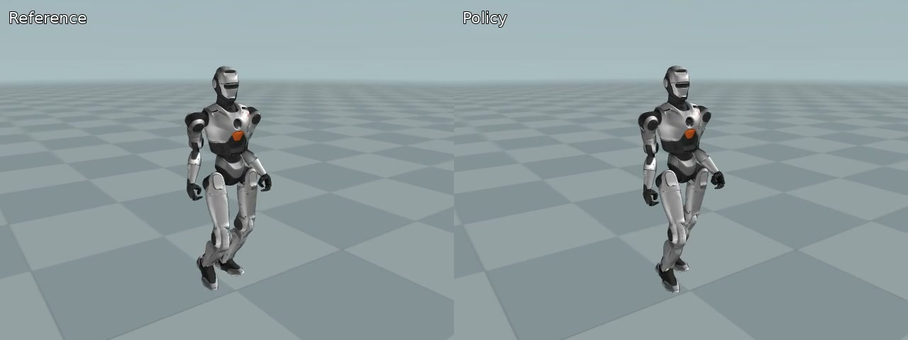

# PM01 65k 仿真跟踪视频

左侧 **Reference** 为动作参考回放，右侧 **Policy** 为同一时刻的策略闭环仿真运动。八段均保留全部帧和原始世界位置，以 50 fps 原速播放。片段按动作类型和实际误差精选。

参考动作来源为 [Motion Data by Bones Studio](https://bones.studio/)。

[](../media/videos/showcase/02_turn_and_walk.mp4)

| 动作 | 显示时长 | 关节 MAE / RMSE | 根位置 XYZ RMS | 最大 / 末帧水平差 |
| --- | ---: | ---: | ---: | ---: |
| [转向行走](../media/videos/showcase/02_turn_and_walk.mp4) · [截图](../media/videos/showcase/02_turn_and_walk.jpg) | 3.52 s | 5.96° / 7.94° | 8.46 cm | 20.06 / 19.98 cm |
| [侧步转向](../media/videos/showcase/03_side_steps.mp4) · [截图](../media/videos/showcase/03_side_steps.jpg) | 6.76 s | 6.81° / 9.92° | 6.48 cm | 10.49 / 8.80 cm |
| [快速锁舞](../media/videos/showcase/04_fast_locking.mp4) · [截图](../media/videos/showcase/04_fast_locking.jpg) | 3.04 s | 7.94° / 11.17° | 4.88 cm | 9.34 / 2.36 cm |
| [交叉步舞蹈](../media/videos/showcase/05_cross_steps.mp4) · [截图](../media/videos/showcase/05_cross_steps.jpg) | 4.44 s | 6.83° / 9.49° | 8.51 cm | 14.15 / 8.88 cm |
| [举臂欢呼](../media/videos/showcase/06_overhead_cheer.mp4) · [截图](../media/videos/showcase/06_overhead_cheer.jpg) | 8.62 s | 7.50° / 10.00° | 7.87 cm | 14.88 / 3.39 cm |
| [摆胯律动](../media/videos/showcase/07_hip_groove.mp4) · [截图](../media/videos/showcase/07_hip_groove.jpg) | 5.52 s | 6.64° / 8.96° | 5.83 cm | 7.99 / 6.64 cm |
| [非对称转身](../media/videos/showcase/08_asymmetric_turn.mp4) · [截图](../media/videos/showcase/08_asymmetric_turn.jpg) | 6.02 s | 6.93° / 9.24° | 9.68 cm | 18.38 / 5.56 cm |
| [跳绳式步法](../media/videos/showcase/09_rope_style_steps.mp4) · [截图](../media/videos/showcase/09_rope_style_steps.jpg) | 6.28 s | 8.39° / 11.05° | 10.65 cm | 19.65 / 5.22 cm |

小数按显示精度四舍五入，判断条件使用原始数值。[逐段 CSV](../media/results/showcase_tracking_65k.csv) · [视频、截图和 SHA-256 清单](../media/videos/showcase/manifest.json) · [选片和探索记录](video_selection_v2.md)

## 仿真与误差

八段使用同一个 seed 13 的 65k Actor，在 CPU 上以 ONNX Runtime FP32 前向和 MuJoCo 3.3.7 物理闭环运行。物理为 200 Hz、策略为 50 Hz，采用零执行延迟和名义控制参数。每段用参考首帧的位姿与速度初始化一次，之后读取实际仿真状态并推进自由根机器人。八段均执行至参考末帧，共 2,202 个控制步和 2,210 个显示帧。每段显示时间包含一个额外的初态帧，合计物理时间为 44.04 s，视频时间为 44.20 s。

关节 MAE 与 RMSE 对全部实际执行步及 23 个受控关节等权计算，排除共用初态和参考驱动的头部。根位置 XYZ RMS 为世界坐标中三维位置差向量的均方根。最大和末帧水平差取相应的水平欧氏距离，两侧画面共用世界相机，保留位置漂移。

八段均用于开发后选片，其中六段来自历史固定 200 监控面板。精确片段 ID 与训练登记清单无交集，源录制层面的重合情况未确定。历史专项评测含训练已见参考，历史原生 CUDA BF16 复测使用另一套协议。持续真机静站、完整敬礼和完整手柄流程尚未验收。[历史评测说明](evaluation.md)

## 可见跟踪范围

- 侧步转向包含末尾约三秒的站定保持，误差统计覆盖整段。
- 举臂欢呼展示手臂协调，策略的竖直起伏小于参考。
- 非对称转身展示转向，单脚平衡能力未验证。
- 跳绳式步法为空手步法，既定双足腾空检测未确认完整腾空。

## 使用与来源

画面中的机器人视觉模型来自 EngineAI Native SDK。发布文件包括压缩结果视频、对应截图和汇总，原动作数据及其数值轨迹按各自来源条款管理。[EngineAI Native SDK 固定版本](https://github.com/engineai-robotics/engineai_robotics_native_sdk/tree/335c60e88772c26c7852d0abd6b3c7439037dd8f) · [第三方声明](../THIRD_PARTY_NOTICES.md) · [媒体科研使用条款](../media/LICENSE.md)

Training data includes [Motion Data by Bones Studio](https://bones.studio/).

Use of the underlying dataset is subject to the [BONES Motion Capture Dataset License Agreement](https://bones.studio/info/seed-license).

## 自有轨迹重放

调试重放工具在左侧显示策略、右侧显示参考，画面叠加误差和时序指标。输入为有权使用的 PM01 视觉 MJCF、配套网格和已录制轨迹。工具需要 MuJoCo 3.3.7、NumPy、Pillow、PyOpenGL、DejaVu Sans 和支持 H.264 的 FFmpeg。[重放脚本](../tools/render_tracking.py)

```bash
python tools/render_tracking.py --trace recorded-trace.npz \
  --visual-model pm01_edu.xml --output comparison.mp4 \
  --title "PM01 tracking" --credit "Motion Data by Bones Studio · bones.studio"
```

输入 NPZ 使用无 pickle 的数值和 Unicode 数组，N 含初态。

| 字段 | 内容 |
| --- | --- |
| `schema`、`onnx_sha256` | `pm01-public-render-input-v1` 和本仓库 65k ONNX 的 SHA-256 |
| `joint_names` | 与推理核心一致的 24 个 PM01 原生关节名 |
| `qpos`、`ref_qpos` | 两个 N×31 矩阵，依次为世界位置 XYZ、根四元数 WXYZ、24 个关节角（rad） |
| `step`、`time_s` | 从 0 开始的连续控制步号和物理秒数 |
| `control_hz`、`physics_hz`、`planned_steps` | 50、200 和原定控制步数 |
| `completed`、`stop_reason` | 到达参考末帧时为 true 与 `reference_end`，提前终止则写实际原因 |
